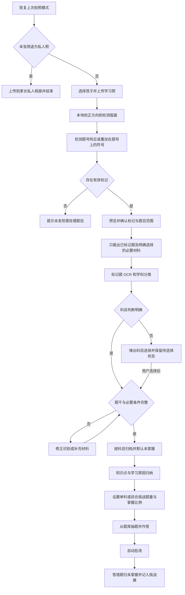
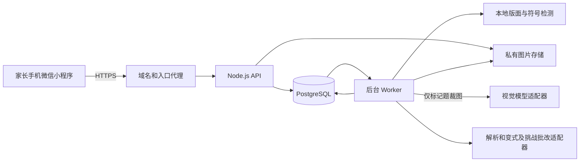

# 江苏中小学标记题学习小程序详细设计
> 业务规则基线 v2.10。当前技术选型和图像/标记自动处理规则以 [CloudBase 家庭轻体验版方案 v3.0](cloudbase-experience-design.md) 为准。本文件中的 Linux 单机架构、人工框选和原图保留描述属于旧技术设计参考，不应覆盖 CloudBase 方案中后续确认的自动定位、预算及保留规则。
本方案面向家长管理一个或多个孩子，覆盖江苏小学和初中全部学科。原卷导入只识别题号有标记的题目，按科目归档并一律默认未掌握。挑战从题库抽题，支持单科和大综合、可调题量与掌握比例，提交后自动批改；挑战答错自动移回未掌握并收录到“挑战赛”目录。高中保留为后续扩展。
方案基于项目 `node` 的业务目标，并以本轮用户修正为准。编写 v2.10 时的旧原型不在当前工作区；2026-10-24 新增了初始 CloudBase/小程序骨架，但识别管线、家庭和孩子持久化及业务接口仍需实现。
最新确认：模型生成相似题并保存至各科新增的“举一反三”，默认每周更新、周期可调；挑战中的部分正确和主动选择不会均迁入挑战赛；题源不足经用户确认可跨掌握池补足。大题计 1 题并按整题迁移；误判纠正满足无后续操作/其他有效错误时恢复迁移前状态；私人照归家长独立相册。评分公式等剩余细节见[设计复查记录](design-review.md)。
当前修订 v2.10。已落实用户最新确认：原卷不判题、全部新归档题默认未掌握、大题标记覆盖全部小问；单科默认 6 题、大综合默认 15 题，数量可调；未掌握与已掌握默认 9:1，可自由设置；挑战答错自动归入未掌握及“挑战赛”。这些规则替代旧版“固定六题”“只抽未掌握”“错误仅建议移回”等约定。
## 一 已确认的业务规则
| 项目 | 规则 |
| --- | --- |
| 使用者 | 家长登录，一个账号管理多个孩子 |
| 地域和学段 | 江苏，小学一年级至六年级、初中七年级至九年级；保留具体学校学制配置能力 |
| 学科范围 | 覆盖全部学科，按孩子实际课表和教材配置，不只提供数学或语数英 |
| 标记位置 | 题号上方、题号旁以及直接叠加在题号上的手写符号 |
| √ | 题型不熟悉，代码 `unfamiliar` |
| 五角星 | 完全不会，代码 `unable`；新规则中 ☆、★ 归为同一种语义 |
| 三角形 | 做题粗心，代码 `careless`；识别手绘三角形，正文中的几何图形和 Δ 不直接当作标记 |
| 识别范围 | 仅处理题号带上述标记的题；未标记题不做题干 OCR、答案提取、判题或入库 |
| 拍照模式 | 首次默认“错题整理”（非私人照）；主动切换后记住上次选择，下次进入沿用 |
| 私人照 | 家长独立相册，不绑定孩子；主动选择或沿用上次私人照模式时，跳过标记检测和全部 AI 识别 |
| 学科判断 | 自动判断已选标记题的科目；判断明确直接进入下一步，不明确弹出科目选择 |
| 科目错题集 | 按孩子和已确定科目归档，支持科目内查看、筛选和勾选题目 |
| 导入归档 | 三类符号用于筛选题目，与原卷作答无关；识别成功且科目确定即归档，不判断原卷对错 |
| 掌握状态 | 所有新归档题默认未掌握；用户可手动标记已掌握或移回；挑战答错、部分正确、主动选不会均归未掌握并迁入挑战赛；答对不自动掌握 |
| 举一反三 | 模型基于题型、学习原因与挑战薄弱点生成相似题，校验后保存至本科举一反三并默认未掌握，供后续抽题 |
| 题库更新 | 默认每周补充举一反三，可调整周期；保留已有题目及作答历史，不以更新为由自动覆盖或删除 |
| 大题范围 | 大题序号标记代表整个大题及其全部小问；挑战整道大题计 1 题，任一小问需再练则整题迁入挑战赛 |
| Word 导出 | 支持将当前科目下勾选题目或全部筛选结果导出为 .docx，提供练习版和解析版 |
| 训练方式 | 单科挑战默认 6 题、大综合默认 15 题，题量可调整；从现有题库按掌握比例抽题，默认未掌握 9 份、已掌握 1 份；相似题生成是独立功能 |
旧需求中的“思路不清晰”和“★ 重点关注”已被最新三类规则替换。历史数据保存其原规则版本，不把旧版 ★ 自动改成“完全不会”。
沿用“错题集”作为入口名称，其原卷内容实际为 √、☆/★、△ 筛选出的归档题，不表示系统判定做错。三类符号保留约定的学习原因含义，但不证明试卷作答对错，也不直接等于二态掌握状态。标记题无论答对、答错还是空白，识别成功后一律归档为未掌握。未标记题仍不识别；补纸面标记或明确添加虚拟标记后才可入选。挑战做错的派生题保留独立来源，首次归档同样默认未掌握。
## 二 全学科与江苏教材
国家义务教育课程包含语文、数学、外语、道德与法治，以及科学、人文、艺术、体育、信息科技、劳动等领域；地方和校本课程需要单独配置。课程结构以[教育部义务教育课程方案通知及附件](https://hudong.moe.gov.cn/srcsite/A26/s8001/202204/t20220420_619921.html)为基础。
首版课程目录包括以下分组，开设年级以孩子实际课表为准，不要求每个年级出现所有学科：
| 分组 | 支持的科目 | 主要纸面题型 |
| --- | --- | --- |
| 基础语言 | 语文、英语及学校实际开设的其他外语 | 字词、阅读、语法、翻译、表达、写作 |
| 数学 | 数学 | 计算、应用题、几何、证明、统计 |
| 科学 | 科学、物理、化学、生物学 | 概念、实验题、计算、图表分析 |
| 人文 | 道德与法治、历史、地理 | 选择、材料分析、地图、论述 |
| 体育与健康 | 体育与健康 | 规则、健康知识、训练方案等纸面题 |
| 艺术 | 音乐、美术及学校开设的艺术子科目 | 乐理、鉴赏、识图、设计说明 |
| 技术与实践 | 信息科技、劳动、综合实践活动 | 算法、项目设计、安全操作、研究性任务 |
| 地方与校本 | 学校实际课表中其他课程和人工智能通识等 | 按课程模板补充 |
江苏已启动中小学人工智能通识教育课程资源建设，因此课程目录应允许新增该类课程，而不是把学科写死在前端枚举中。[江苏省教育厅公开信息](https://jyt.jiangsu.gov.cn/art/2026/8/19/art_57807_11818141.html)
每个孩子按“省份、城市、学年、年级、学期、学科、出版社、教材版本、册次”配置教材。江苏不能简单等同于所有学科都是苏教版；使用课本封面、版权页和学校清单确认版本，未配置时显示“教材待确认”，不伪造章节编号。
知识点使用“课标领域 → 学科 → 学段年级 → 教材版本 → 单元 → 知识点”的映射。模型只建议候选知识点；无法对应既有目录时进入待整理节点，由家长修正或维护人员补充，不自动新增同义重复节点。
体育、音乐、美术、实验等学科导入时只识别已标记的纸面题目要求及图表，不评价原卷作答或实际操作表现。参考解析与挑战批改中的开放题采用要点或评分细则，证据不足时待复核，不伪造唯一答案。
## 三 家庭和孩子的数据归属
家长通过微信登录成为用户，首次创建家庭及孩子档案。家庭默认仅本人可管理；“邀请另一位家长”作为可扩展功能，不默认公开孩子题库。孩子档案使用昵称、年级和教材配置，不要求身份证号、手机号或真实学校名称。
学习照片、题目、学习任务、挑战和统计均带 `family_id` 和 `learner_id`。服务端根据登录用户的家庭权限校验每次操作，不能只相信前端传来的孩子 ID。家长切换孩子时清空当前学习筛选、预览和未提交操作上下文；已有挑战保持原孩子归属。
学习照上传前必须选定孩子，并在上传确认按钮附近显示孩子昵称。归属选错时，单张学习照片及其原始题目转移须有影响预览与明确的历史处理合同；不能只更新 learner_id。已有挑战、掌握历史如何处理仍见复查记录 D04，未完成该合同前不提供直接转移入口。
私人照归当前登录家长的独立相册，使用 `owner_user_id`，`learner_id` 和 `family_id` 为空；不要求先创建或选择孩子。同一家长切换孩子时私人相册不变，切换账号则完全隔离；家庭管理权限不能自动获得另一家长私人相册访问权。私人照不进入孩子题库、科目统计、生成或挑战任务。删除孩子档案不删除家长私人相册；删除私人照或家长账号需走各自的删除范围与任务。存储访问、缓存、缩略图和删除任务都按相册所有者校验。
## 四 页面与交互
| 页面 | 主要内容与操作 | 空态或异常 |
| --- | --- | --- |
| 家庭首页 | 当前孩子、归档题数量、待修正任务、单科/大综合挑战入口、挑战赛错题入口、最近记录 | 未建孩子时先创建档案 |
| 孩子管理 | 新增、切换、修改年级、学期和各科教材 | 孩子不能跨家庭枚举 |
| 拍照与上传 | 相机/相册、方向调整、学习照孩子确认、错题整理/私人照、记住上次模式、上传用途确认 | 首次默认错题整理；私人照不要求选孩子，权限拒绝可重试，上传失败保留本机照片 |
| 我的私人相册 | 当前家长私人照列表、查看、删除、主动转学习照 | 不随孩子切换；转学习照必须选择有权限的孩子 |
| 标记预览 | 原图、标记框、题号区域、对应题目范围；允许补标、取消误检、修正边界 | 没有标记则结束流程，不触发整卷 OCR |
| 识别任务 | 排队、检测、识别、待选科、待修正、归档进度 | 可离开页面，回来继续；失败有重试按钮 |
| 科目选择弹层 | 仅对判断不明确的已选题显示候选科目、全部科目和暂不处理 | 明确的题自动继续；取消选择保留待选择状态 |
| 题目修正 | 裁图、题干、图表、教材知识点、标记和科目 | 遮挡或缺条件时修正内容；不复核原卷作答对错 |
| 科目题库 | 每科并列“整理、举一反三、挑战赛、已掌握、所有题型”，按来源、原因、知识点、题型、日期筛选 | 前四菜单互斥，所有题型去重汇总，未发布草稿不入库 |
| 举一反三与更新设置 | AI生成标识、来源题、题型、生成批次、手动更新、周期及更新记录 | 默认每周，失败可重试；不合格题不发布，费用上限可暂停 |
| 掌握状态操作 | 错题卡片和详情显示状态，可“标记已掌握”或“移回未掌握”；支持明确勾选后的批量操作 | 切换成功刷新列表与数量；失败保留原状态，版本冲突提示刷新 |
| Word 导出 | 当前科目勾选题或全部筛选结果、练习版/解析版、题数预览、生成进度和文件下载 | 空结果不能导出；失败可重试，文件失效可重新生成 |
| 知识点归纳 | 三类原因、掌握状态、复习历史、挑战表现 | 不统计原卷错误率，不自动认定已掌握 |
| 挑战设置 | 单科/大综合、题量、掌握比例、可用题数及实际配额预览 | 缺额显示跨池补足方案，用户确认后执行；不重复、不临时生成题 |
| 挑战作答 | 逐题作答、题号导航、云端草稿、可选拍照作答 | 实际题数以本场配置快照为准，全部作答或明确不会后提交 |
| 挑战结果 | 自动批改、逐题反馈、成绩、参考答案与解析 | 答错/部分正确/主动选不会均迁入挑战赛；模型判断不可靠的待复核 |
| 挑战赛 | 按孩子、单科/大综合、场次、科目查看挑战错题及当前掌握状态 | 历史错题记录保留，重复答错不重复复制题目 |
| 我的与数据管理 | 家长信息、孩子、模型处理说明、删除、挑战历史 | 失败操作可恢复并有明确状态 |
首版先由用户确认标记与题目范围，再启动文字识别。在手写识别准确率尚未建立时，通过范围确认阻止误检题进入 OCR。后续是否提供自动确认需基于独立样例另行评估，不作为绕过未标记题排除规则的方式。
### 拍照模式记忆
首次进入拍照页时使用“错题整理”。家长主动切换为“私人照”后，当前待上传照片使用私人照模式，下次进入仍为私人照；切回错题整理后同样记忆。相册上传沿用同一规则。拍照页与上传按钮附近始终显示当前模式，私人照显示“仅保存，不识别”。系统不根据图片内容自动切换用途。
首版实现约定：模式按本机登录账号保存为 `lastCaptureMode`，取值 `study` 或 `private`，切换时立即保存，取消拍照或上传失败不回退。切换孩子沿用当前家长的模式，切换账号读取各自偏好；新设备或本地缓存清除后无历史时默认错题整理。跨设备同步暂不作为首版要求。恢复已有上传草稿时以草稿自身模式为准，不能由全局偏好覆盖；上传请求显式携带本张照片用途，服务器不得因缺省字段而启动识别。更改偏好只影响待拍或待上传照片，历史照片用途需单独修改。
## 五 仅识别标记题的处理管线

### 图像和标记定位

> **2026-10-25 修订**：标记检测改为混合管线 —— 视觉大模型做"哪几题、哪类标记"的语义判断，`QuestionSplitOCR` 提供题目几何坐标与题干文本。原"整页只在自有 Linux 服务内定位、不送云端模型"的约束仅对私人照保持；学习照的整页视觉判断已获用户明确豁免（见 requirements R44–R47）。原卷对错字段仍然禁用。

整页只做本地版面、题块边界和符号定位，不对整页题干进行 OCR，也不把整页送给云端模型。照片保留原图作为凭据；工作副本做 EXIF 方向处理、透视校正和必要去噪，保留彩色原图以供复核。
这里的“本地”指自有 Linux 服务器内的检测服务，不表示已在微信手机端部署模型。手机负责拍照、预览与范围修正；服务器上的版面和符号定位仍不得转写未标记题干。模型输出校验与日志同时覆盖本地服务和云端请求，不能只用“未调用云端”证明未标记题没有被识别。
标记检测以题号区域为重点，并结合行列、缩进、分隔线和题块边界。识别器输出符号类别、包围框、关联题号区域和定位质量；题号文字和标记分开处理，不能把“题号加标记”的连通区域直接当作普通数字。
符号直接覆盖题号时，题目 ID 仍由系统生成，原题号可标为不可读；利用相邻题块和阅读顺序定位，不猜测被遮住的编号。保留原题号区域与符号裁图，支持人工框选正确题块。
新规则版本 `mark-v2` 将 √、☆/★、△/手绘三角映射到三类原因。正文根式、几何三角形、五角星图案和老师的普通批改勾不能仅凭形状自动入选，需同时符合题号区域关系；判断有歧义时提示复核。多个标记附着同一题号时保留全部检测证据，允许同题多标签，不重复建题。
本地检测建议采用版面检测和符号检测模型，经实际手写样例微调后以 CPU 推理服务部署。实现前必须验证模型和样例的可用性；不能把“模型能识图”当作已经解决覆盖题号的手写检测。首轮必须提供人工补标和边界修正，作为漏检与遮挡的恢复路径。
### 题目范围与必要材料
只对确认入选的题目生成 OCR 工作裁图。题块跨页、引用阅读材料、图表或共用题干时，默认不自动读取其他未标记题；用户可明确框选该题必需的材料作为上下文。没有获得必要材料时返回“缺少条件”，不得猜答案。
已确认：大题序号有标记即选中整个大题及全部小问，小问无需再次标记；仅小问有标记则选该小问及已确认的共用条件，其他未选大题或小问不识别。大题与其小问同时标记时按层级去重，保留小问标签而不重复建题。题块边界不确定时先修正，不扩大到整页。
工作裁图不能包含相邻未标记题干；检测框覆盖多题时先做边界修正。如果无法可靠分割，任务暂停在范围待确认，不能以识别整张照片代替。云端请求日志记录所用裁图 ID 和范围，验收时据此核查未标记题未发送。
学段和学科自动分类基于已标记题裁图，并参考孩子的年级配置；没有标记时只保留家长输入的元数据，不额外调用整页分类模型。混合学科照片可按题目分别分类，照片层保存汇总科目。
### 自动判断科目与选择兜底
用户无需在拍照前填写科目。确认标记范围后，根据裁图中的文字、公式、图表和题意判断科目，可与 OCR 共用一次模型调用。科目明确且题目识别完整时直接归档，不要求再次确认科目或原卷对错；结果显示科目并保留修改入口。标记范围确认仍用于保障仅处理选中题目。
“判断明确”需要候选属于有效课程目录、证据足够且无明显冲突，并达到用实际样例校准的接受标准，不能仅凭模型自报高置信度。语文与历史阅读题、数学与物理计算题等存在歧义时，弹出候选科目并提供完整课程选择；允许暂不处理，不能关闭弹层就默认选第一项。网络或模型故障显示可重试错误，也可手动选科，但手动选科不能替代尚未成功的题干识别。
学科状态按题块保存为 `auto_accepted`、`needs_selection` 或 `user_selected`。待选科题暂停正式科目归档、知识点映射与出题，其他明确题可独立继续。只有用户主动指定才把选择应用于多个题。科目修改保留题目 ID 与掌握状态，重新映射知识点并使旧科目的参考解析、导出和生成结果失效；不触发原卷判题。
私人照不进行科目判断。无标记照片不为判断科目而扫描整页；也不根据上一次拍照科目直接归类本次题目。年级和教材仅提供上下文，不将跨学科题强制归入某个常用科目。
### OCR 与直接归档
识别输出为题干、选项、结构化小问、题目自身条件、必要图表、科目和候选知识点。不提取学生原作答，不比较原卷对错，不创建原卷判题任务。裁图中的手写答案与老师批改痕迹只作为图像证据，不能写入题干或当成已知条件；无法分离时提示修正或补拍。
标记范围已确认、题目内容完整且科目确定后直接归档，同时创建未掌握状态，不再增加对错复核步骤。模糊、遮挡或缺少必要条件时保留待修正草稿；完成修正再归档。教材章节或知识点暂不能匹配时进入待整理分组，不阻止完整题目归档。科目不明确时先选择科目。
导入模型输出结构禁止原卷 student_answer、verdict、score 等字段；供应商额外返回时丢弃并记录结构异常，不展示、不保存到归档题、不用于筛选。题目、归档与掌握状态写入同一事务，任务重试复用已有记录。结构校验、范围校验、识别来源和版本均留痕。
### 科目归档与 Word 导出
按“孩子 → 科目”组织题库，每科下五个菜单并列，默认进入“整理”，不再增加“未掌握题型”父目录。对原卷答对、答错、空白不做区分。混合科目照片按题归档，详情保留题干、图表、裁图、原因标签、掌握状态、分类及来源。
```text
数学
├─ 整理
├─ 举一反三
├─ 挑战赛
├─ 已掌握
└─ 所有题型
```
| 菜单 | 内容及条件 |
| --- | --- |
| 整理 | 拍照上传、通过 √/☆/△ 筛选并成功归档，当前未掌握且尚未迁移到挑战赛的题 |
| 举一反三 | 模型生成并通过校验、已发布到题库的相似题，当前未掌握且未迁入挑战赛 |
| 挑战赛 | 单科或大综合挑战答错、部分正确、主动选不会后迁入，当前仍未掌握的题 |
| 已掌握 | 从整理、举一反三或挑战赛主动标记已掌握后迁入的题 |
| 所有题型 | 整理、举一反三、挑战赛、已掌握四处题目的去重并集，显示当前菜单与状态 |
前四菜单互斥。整理或举一反三的题迁入挑战赛后退出原菜单；主动标记掌握后迁入已掌握。所有题型是去重汇总，题目总数=整理+举一反三+挑战赛+已掌握，同一题多标签、多次挑战只计一次。未完成识别的草稿、未发布生成题、私人照和已删除题不入五菜单。
菜单迁移不能只比较 mastered/unmastered：organized → challenge 虽然同为 unmastered，仍必须更新 collection、增加版本并写迁移事件。只有“相同请求已成功”或目标菜单/状态均一致时才可幂等返回；再次独立挑战答错仍增加新的作答事件。列表、分页总数及导出范围使用同一页面查询条件。抽题与它们共用家庭/孩子隔离、有效题目和菜单/掌握归属规则，但另按挑战科目范围、可练资格及配额查询，不继承当前页面标签筛选。
#### 当前页面的三类标签筛选
在“整理、已掌握、所有题型”的列表上方增加三个可切换按钮：`√ 题型不熟悉`、`☆ 完全不会`、`△ 做题粗心`。三个按钮默认灰色，表示全部包含，显示当前孩子、科目和菜单范围内的全部题目；已有知识点等筛选仍生效。点击某按钮由灰色变白色，表示排除该标签；再次点击恢复灰色并取消排除。灰色不是禁用状态，按钮需同时显示“包含/排除”状态及清楚的文字和边框，避免只靠颜色区分。此新增按钮组适用于用户指定的三个菜单。
按用户最新修正，多标签题采用“任一仍包含的标签命中即显示”（灰色标签之间为 OR）：白色仅表示不再选用该标签匹配，不否决其他灰色标签的匹配。题目至少有一个标签对应灰色按钮就显示，只有该题的全部三类标签都对应白色按钮时才隐藏。例如 √ 白、☆/△ 灰时，只有 √ 的题隐藏，√+☆、√+△ 及只有 ☆ 或 △ 的题仍显示；√ 和 ☆ 均白、△ 灰时，√+☆ 题隐藏，√+☆+△ 题仍显示。三个全灰恢复本菜单全部匹配题；三个全白隐藏所有带这三类标签的题。没有三类标签的生成题或挑战题沿用保留规则，仍可显示在已掌握/所有题型中；不为筛选而自动补标签或继承来源题标签。若无匹配题，显示空状态和“重置筛选”，不改动题目归档。
按钮只改变当前页面查询，不修改题目标签、掌握状态、目录或挑战抽题配置。设计默认在当前页面生命周期内保留，进入另一菜单、科目、孩子或重新进入页面时恢复全灰；详情返回保留当前筛选。筛选变化重置分页和勾选，刷新匹配数量，忽略旧请求的迟到响应。列表、分页总数及“导出全部筛选结果”共用同一排除条件，批量操作仅作用于重新显式勾选的可见题。
服务端查询使用 `excluded_mark_types` 表示不再选用的标签，即白色按钮对应的规范标签枚举列表，默认空数组；非法枚举拒绝，重复值去重。设三类规范标签全集为 T，白色集合为 E，灰色集合为 S=T−E，题目具有的三类标签集合为 Q。标签条件为 Q 为空，或 Q 与 S 有交集（无三类标签 OR EXISTS 匹配灰色标签），再与孩子、科目、菜单及其他筛选条件取交集；不能使用“命中任一白色标签即排除”的查询。同题多标签不重复计数。导出任务保存该条件及匹配题快照。☆/★ 共用“完全不会”规范标签，旧规则版本的星号不擅自重映射。
筛选读取题目级 `question_labels`，照片上的 `question_marks` 保留识别证据，二者不混用。导入归档时把已确认的三类标记映射到题目标签；人工修正标签留版本与审计，不删除原始检测证据。生成题不因来源题有标签就自动继承；挑战主动选择“不会”是本次作答结果，不自动赋予题目 ☆ 标签。没有题目级标签的题遵循上述无标签规则。整道大题归档时，题目级标签默认取大题及入选小问已确认标签的并集，保留各标记的原始位置；不把小问标签反向加到其他小问。该汇总是整题筛选的实现默认，不改变仅选小问时的识别范围。
五个菜单均支持勾选题目或导出本菜单全部筛选结果（含分页外匹配项）为 Word（.docx）。导出默认跟随所在菜单，不混入其他菜单题；所有题型导出取去重并集。生成前显示科目、菜单、题数、筛选和版式；零题不生成。同题多次挑战错误导出一次题干，可附场次列表。菜单迁移也属于导出来源状态变化，旧服务端文件失效后可重生成。
| 版式 | 内容 |
| --- | --- |
| 练习版 | 题干、必要图表、连续题号、作答空白；不含原图中的手写作答、批改提示、参考答案与解析 |
| 解析版 | 题干、图表、原因标签、掌握状态、知识点、参考答案与解析及来源；无原卷对错字段；从挑战赛导出时可选附对应场次作答与批改 |
参考答案/解析是独立辅助内容，按用户查看解析或导出解析版的操作生成或引用，不比较原卷作答，也不作为原卷归档的前提。答案不可靠或缺失时明确标注，生成失败保留题目与掌握状态；解析版需提示未准备好的题，不能默默遗漏或编造答案。用户可先导出练习版。
普通文字尽量可编辑，复杂公式/图形允许用清晰图片。只能使用已选题及明确授权的必要材料，不插整页试卷。练习版图像若包含作答或批改，须裁除或安全重建；不能保证时要求处理并报告受影响题目，不静默输出答案或删题。未完成挑战不能通过导出取得该场未公开的作答、评分或参考答案。
导出任务固定题目 ID、内容版本、掌握版本、顺序和筛选快照；已有题目可直接排版，不重新扫描照片。服务端校验家庭、孩子和来源权限。来源修改、删除或掌握变化使关联服务端导出失效，可重生成；已下载副本不能远程撤回。文件私有保存、鉴权下载，初始建议保留 24 小时，可配置。Word/WPS 和微信真机打开、保存、分享均需实际验收。
### 掌握状态与已掌握题型
所有新识别归档题一律初始化 unmastered（未掌握）。这是用户明确指定的初始管理状态，不是 AI 根据原卷推断的能力结论。三类符号表示筛选原因，mastered/unmastered 表示归档后的进度，两者独立。
| 信息 | 保存位置与作用 |
| --- | --- |
| 题目内容及标记 | 归档题；原卷导入不存学生原作答和原卷判题 |
| 掌握状态 | 每个孩子每道归档题一条状态记录，默认未掌握 |
| 挑战作答与批改 | 对应场次的尝试记录，保存本次答案、判题和成绩 |
| 挑战答错事件 | 挑战赛目录的关联记录，指向归档题和对应尝试，不复制题干 |
“已掌握”菜单按知识点和题型分组，但状态粒度为单题。改变一道题不扩散到整个知识点或其他同类题。缺少题型映射可在当前菜单的待分类分组显示，不改变所在菜单。
1. 拍照题首次归档为未掌握并入整理；模型生成题通过校验首次发布为未掌握并入举一反三。重试、定期更新与内容修正不重置已有菜单或状态。
2. 从整理、举一反三或挑战赛主动标记掌握后迁入已掌握，记录迁入前菜单。手动取消掌握默认回到此前菜单；批量操作校验权限与版本并事务执行，历史保留。
3. incorrect、partial 以及用户主动选择不会的 unanswered 均设为未掌握并迁入挑战赛；从整理/举一反三/已掌握退出原菜单，已在挑战赛则新增事件而不复制题目。结果中仍分别显示答错、部分正确、不会，不把三者伪装为同一评分。
4. needs_review 本身不触发迁移；若整题仅有不确定结果且没有任何确定需再练的小问，暂不迁移，待人工复核。大题中已有确定错误的小问按该证据迁移，不能把其他小问的不确定当成错误。空草稿、断网未提交、识别失败不等于用户主动选不会，不能自动判为 unanswered。复核改为正确时更新有效事件；若此前因该次误判自动迁移，且无后续操作或其他有效错误，则恢复迁移前目录及掌握状态。恢复原先已掌握是撤销错误迁移，不是答对自动掌握；有后续操作或其他有效错误则保留现状并提示人工处理。
5. 科目修改时掌握状态随原题迁移；文字或材料修改保留状态与修订历史，严重内容缺失时暂停新挑战选题，不能依据原卷对错移除题目。
6. 未掌握池=整理∪举一反三∪挑战赛，已掌握池=已掌握；所有题型不是额外题源。按有效作答分别统计答错、部分正确和不会，原卷无错误率。来源标识与菜单独立，生成题迁出举一反三后仍显示 AI生成及来源链。
自动错误迁移与用户手动修改通过状态版本保护。批改写回按本次提交捕获的状态版本执行；如果用户在提交后又手动修改了状态，保留较新的人工决定，错误事件仍保存，并提示本次错误建议移回，等待用户处理。仅其他错误迁移使当前已为未掌握时可幂等记错。迟到的后台结果不能覆盖更晚的人工操作。
## 六 单科挑战、大综合挑战与相似题生成
### 挑战模式、数量与比例
挑战直接从当前孩子已有、内容完整、科目确定且未删除的题库抽题。两种模式均支持调整题数，以及未掌握/已掌握比例。原卷做题情况不是选题条件。手动已掌握题可参与配置比例要求的抽题。
| 模式 | 科目范围 | 默认题数 | 默认掌握比例 |
| --- | --- | --- | --- |
| 单科挑战 | 用户先选择一个科目 | 6，可调整 | 未掌握 9 份、已掌握 1 份 |
| 大综合挑战 | 当前孩子所有已归档科目 | 15，可调整 | 未掌握 9 份、已掌握 1 份 |
比例以 10 份表示，未掌握权重 u 可在 0—10 间按整数调整，已掌握权重为 10-u，支持 10:0 与 0:10。题数 N 为正整数；实现默认允许 1—50，50 是可配置资源保护上限，不是用户业务限制。超过部署上限明确提示，不截断。设置按家长与模式分别保存，下次恢复；已创建挑战不受后来配置修改影响。
配额规则固定为：未掌握题数 U = floor(N × u / 10 + 0.5)，已掌握题数 M = N-U；半题取整优先未掌握。界面生成前展示实际道数和百分比，不能声称整数配额精确等于输入比例。例如 6 题、9:1 得到 5+1；15 题、9:1 得到 14+1。比例是本场总体比例，不要求每个科目单独满足。
服务端先计算目标 U/M，再校验两池可用量 aU/aM。某池不足且总量不少于 N 时，展示缺额、补足来源、实际道数及比例，由用户明确确认后跨池补足。例如目标 5+1、实际无已掌握但有 6 道未掌握，提示改为 6+0；未确认不得创建场次。仍可选择调整题量/比例或取消，总量不足时不能补成 N 道。
补足方案保持 N 不变、尽量接近目标配额：实际 U'=min(max(U, N-aM), aU)，M'=N-U'，前提 aU+aM≥N。两池足够时不变。确认只授权本次预览的实际配额及科目范围，不修改长期 9:1 偏好；创建时重新校验，如需再改实际配额则返回新方案重新确认，不复用旧确认。记录目标配额、实际配额、缺额、确认用户/时间及预览版本，不重复题、不在抽题中临时调用模型生成补题。
大综合在每个掌握池内轮换科目，同科目随机无重复，按原目标配额或用户确认的补足配额抽取。科目多于题数时不保证每场全覆盖，科目不足时展示实际范围。跨池补足不越过当前孩子和科目范围。
抽题事务固定 mode、N、权重、目标及实际 U/M、补足确认记录、科目范围、题目 ID/内容版本/掌握状态快照及顺序；同题仅出现一次。候选池提交时变动则重新校验配额，不能交付少题或未经确认改变比例的场次；实际配额需要再次变化时须重新确认。ready 前发现来源失效时重新选择或明确失败；ready/开始后保持本场数量及快照，后续掌握变化不删题。删除、用途转换等访问失效仍能使相关挑战失效。
### 作答、自动批改与成绩
Q11 已确认：挑战以归档题实体计数，含多个小问的大题整体计 1 题、占 1 个掌握配额；小问答案及批改结果分别记录，但掌握状态和目录以整道大题为单位。任一小问明确答错、部分正确或主动选择不会时，整道大题迁入挑战赛；全部小问正确才算整题正确。不确定的小问本身不触发迁移；若其他小问已有确定错误，可按该错误迁移，但全题成绩仍标待复核。只标某个小问而独立归档的题也计 1 题，不据此扩展到未标记的小问。单题/场次评分公式另见复查记录，不能把“计 1 题”直接理解为各小问等分。
每场须恰好有配置的 N 道有效题才可 ready。参考答案和评分细则在挑战准备阶段独立生成或校验，不能直接把原卷手写答案当作标准答案；准备失败不可开始，也不改变归档题及掌握状态。题库抽题不生成新题、不改变题意。
“已归档”与“可用于挑战”分开记录：内容完整的题可以先归档，但缺少干净题干、有效参考答案或评分细则时，不计入可立即开赛库存。预览分别展示归档数量、可练数量及暂不可练原因；可单独准备已有题的参考解答后刷新预览，不以此为由新生成题或静默更换配额。ready 门槛为所有入选题的内容、干净展示材料、参考答案及评分版本均有效。准备任务失败可重试，不将失败当作孩子答错。
挑战展示清理后的题干与必要图表，不能直接使用带原卷作答、老师批改或答案提示的裁图。图像处理沿用练习版的去答案要求；无法安全分离时标记本题暂不可用于挑战，重新校验两池数量和配额，不无声删题或换用不合配额的题。
按本场 N 道题保存云端草稿。每题须作答或明确选择不会后提交，幂等提交只创建一次批改。批改结果为 correct、incorrect、partial、unanswered、needs_review；可信结果自动评分，不可靠结果留待复核，不强判错误。客观题校验选项/数值/单位，过程题按步骤与评分要点，开放题使用评分细则；依据不足时请求人工评价。
一套抽出的题目（challenge）与一次作答（attempt）分开：创建作答返回 attemptId 并固定本次题目、参考答案版本和顺序；再次练习创建新 attempt，不覆盖之前成绩。并发开始或重复点击通过幂等标识返回同一活跃 attempt。每次作答独立保存草稿、提交、批改和复核状态。参考答案是否已在前一次作答公开不影响历史保留，系统不把用户已知答案当作从未公开。
Q10 已确认：手写过程题可选择纸上作答，再拍照提交到当前挑战题；选择选项或输入答案仍可用，拍照不是强制步骤。图片关联当前 attempt 和题目，不需要 √/☆/△，因为用户已明确选定要提交答案的题。原卷导入仍只识别带标记的题目。实现需校验孩子/场次/题目、保护提交版本并异步识别手写答案；模糊或识别不可靠时提示补拍/修改或进入待复核，不直接判错。
结果显示本场实际题数、答对/部分正确/答错/不会/待确认数量，题数统计分母为 N，不写死六或十五；百分制等成绩公式尚待 Q12 确认，不能用题数分母替代得分定义。含待复核小问的大题计为一题待确认，已确定需再练的证据另存，不重复计入多个整题结果桶。允许部分分时单独显示得分与评分细则。未提交时只返回作答所需字段；提交后可以查看当前批改进度和已产生的逐题结果，review_required 必须能查看待处理项并进入复核，不将暂定成绩显示成最终成绩。已完成题目的答案和解析可随其批改结果开放；不能通过题目详情、导出、缓存等接口泄露该场尚未公开的评分数据。用户之前已学过相同题目属于复习的正常情况，不承诺用户从未见过参考答案。
### 挑战赛目录与错误归档
“挑战赛”是各科目下与整理、举一反三、已掌握、所有题型并列的错题菜单，路径为“当前孩子 → 对应科目 → 挑战赛”。单科和大综合中答错、部分正确或主动选择不会的题均逐题迁入所属科目的挑战赛菜单，菜单内按题型分组，保留原模式和场次。例如综合中的数学分数应用题进入数学/挑战赛的相应分组，语文阅读题进入语文/挑战赛。不是把一场综合错题统一归入一个科目。
科目和题型取自原归档题的有效分类，不根据挑战模式重新猜测，不根据 √/☆/△ 原因标签改变所属学科。缺少题型时进入该科“待整理题型”分组，保留原原因标签，后续修正分类后更新所在分组。题型归档仅作用于本题，不将同一题型的其他题批量移回未掌握。
挑战赛菜单仅显示当前归属为挑战赛的未掌握题。全部历史错误在挑战历史或题目详情查看，已迁入已掌握的题不再混入挑战赛菜单。保留原场次和分类快照；修正科目后题目携带菜单归属迁到新科目，历史快照不改。
挑战引用原题库题时，错误处理对同一题执行菜单迁移和状态变更，再增加错误事件，不创建第二份题目。多次答错是一题多事件；整理或已掌握迁出后，各菜单数量同步更新，所有题型总数不变。历史事件不决定当前菜单；晚到批改仍遵守较新人工决定的版本保护。
批改、错误事件、掌握迁移与目录关联通过事务和幂等键完成，attempt_answer_id 唯一，重试不重复计错。场次结果复核由版本控制，只统计最新有效判题事件，同时保留修改历史。错误归档与移回未掌握不扩散到该题来源或同知识点其他题。
Q08 已确认并采用补偿事件实现：记录每次自动迁移的迁移前目录、掌握状态、previous_unmastered_collection、迁移后版本以及触发作答事件。复核纠正后先撤销对应错误事件的有效性；仅在该事件确实造成过迁移、当前状态版本仍等于其迁移后版本、且无后续操作和其他有效错误时，事务恢复迁移前完整状态，写入新的补偿事件而不抹去历史。已在挑战赛而本次仅记错的题不凭空恢复；不能确定或版本冲突时只更新成绩/有效错误并提示处理。重复复核请求幂等，复核记录保留原结果、纠正结果、理由和操作者；参考答案也错时单独修订评分版本，其他历史场次不静默重新评分。
### 相似题生成与重复记录
相似题生成是题库建设流程：按本孩子的科目、题型、知识点、√/☆/△ 学习原因，以及挑战中答错/部分正确/不会的记录归纳练习需求，模型生成变式并校验后发布至“举一反三”。不根据原卷作答推断错误；原卷仍只识别标记题。每道生成题记录 AI生成标识、来源题 ID/版本、题型、知识点、难度目标、模型/提示词版本和生成批次。
生成流程为计划 → 生成草稿 → 校验 → 发布题库。校验包括条件自洽、题目/答案匹配、必要图表存在、年级教材适配、结构与重复检测；不合格题留待修正或拒绝，不加入抽题池。合格题发布到举一反三并默认未掌握，之后挑战从持久题库抽取，抽题时不现场生成题。生成题可在举一反三查看/筛选/导出、主动标掌握；挑战需再练时迁至挑战赛并保留生成来源。
### 每周题库更新
默认每周更新一次，可按孩子/科目调整周期、执行时点、目标题型库存及单次生成上限，支持手动立即更新、暂停与恢复；时区为 Asia/Shanghai。定期更新部署在项目后台持久调度系统，不依赖手机在线。当前仅完成设计，尚未创建或启动实际定时任务。
每次更新优先补充有未掌握需求、近期挑战需再练且可用变式不足的题型。按题型计算目标库存缺口，受每批数量与费用上限约束；没有合格来源或库存已满足时记录跳过，不机械重复生成。每批发布报告成功数量、重复拒绝、不合格、费用及失败原因。批量目标、预算、执行时点在部署时配置，未经配置不无限生成。
“更新”默认增量补充：不覆盖已发布题干、不删除已掌握题或历史挑战、不把旧题状态重置。需要修正已发布内容时另建版本；无效题退出未来抽题池，已经开始的挑战按失效规则处理，历史快照可追溯。重复调度以孩子/科目/调度周期及计划版本幂等，重启恢复未完成批次，不重复发布同题；来源修改、删除或转私人照使旧生成任务停止写回。
统一题目实体区分 photo/generated；photo 必须关联已确认标记范围，generated 必须关联合法生成题及来源链，不能伪造照片标记。参考答案与学生作答分开保存。挑战题目和原题 ID 直接关联，作答结果永不覆盖题干、原卷信息或其他尝试。
同一孩子同一生成题只归档一条，多次重做保留各次作答。上传与识别采用幂等标识，同请求重试复用已有资源；另次上传相同文件提示已有记录，可明确作为新一次作业保存。不自动合并近似题、不同作答，不跨孩子/私人用途复用识别。相似去重只能使用已经合法识别的内容，禁止为此读取未标记题。
## 七 技术架构
基于已盘点服务器，建议使用原生微信小程序加 TypeScript，后端使用 Node.js 24、Fastify、PostgreSQL 和持久化后台任务。系统以单台 Linux 的独立 Docker Compose 项目部署，不要求改动宿主机 Node.js 22 或现有业务容器。

API 处理身份、上传、权限、抽题配置、查询和草稿；Worker 处理图像、OCR、参考解析、独立变式生成和挑战批改，原卷导入不派发判题任务。本地检测服务在自有 Linux 内部网络运行。PostgreSQL 存题目、掌握、场次作答及持久任务，图片私有保存，访问统一鉴权。
数据库内任务可采用 pg-boss，复用 PostgreSQL 而不强制增加 Redis；它提供后台任务、重试和并发控制。[pg-boss 官方仓库](https://github.com/timgit/pg-boss) 实际业务仍必须按任务可能重复执行设计幂等，不能依赖“调用一次”假设。
Fastify 用于路由、参数校验和输出投影；实现时锁定当前受支持版本及依赖，使用持续集成验证 Node.js 24 的兼容性，不沿用过期大版本。[Fastify 支持策略](https://fastify.dev/docs/latest/Reference/LTS/)
| 组件 | 首版建议 | 扩展方式 |
| --- | --- | --- |
| API | 一个进程 | 随 API 测量结果增加实例 |
| Worker | 一个进程，初始两个并发模型任务 | 按模型配额和资源分别控制队列 |
| 检测服务 | CPU 推理，单独限制内存和线程 | 有真实负载依据时增加推理实例或 GPU |
| 数据库 | 独立 PostgreSQL 容器及持久卷 | 后续迁移托管数据库或专用实例 |
| 图片 | 私有持久目录，独立文件索引 | 替换为对象存储，不改变业务 ID |
| HTTPS | 容器入口代理或现有公网网关 | 根据实际公网路径确定证书终止位置 |
线程、并发、超时和配额是初始设计参数，不能从 CPU 数量推导出模型处理速度。内存与磁盘配额应保留服务器既有工作负载的空间。
## 八 模型服务与账户
识别、参考解析、变式生成与挑战批改使用分任务适配接口；原卷 OCR 不请求对错输出。适配器声明 vision、structured_output、text_reasoning、max_image_bytes 与协议能力，不能把供应商专属参数直接用于其他服务。
| 用户提到的服务 | 本方案中的接入判断 | 所需信息 |
| --- | --- | --- |
| DeepSeek | 可作为视觉和文本候选，依账户实际模型权限验证 | 官方 API Key、当前可用模型 ID、配额和账单权限 |
| 豆包 | 通过火山方舟开通图片理解及文本模型 API | 方舟 API Key、模型 ID 或推理接入点、地域和额度 |
| coplit | 具体产品尚未确认；如为 GitHub Copilot，有官方后端 SDK，但认证与计费需按其服务方式单独接入 | 产品全名、计划及是否选择其官方后端接入方式 |
DeepSeek 官方现有视觉接口支持图片输入，不能沿用旧知识断言“DeepSeek 一律不能识图”；具体模型以调用时可用清单为准。[DeepSeek 视觉文档](https://api-docs.deepseek.com/guides/vision/)
豆包图片理解应以火山方舟 API 权限为依据，手机或网页聊天账号本身不证明已开通 API。[火山方舟图片理解](https://docs.volcengine.com/docs/ark/image-understanding?lang=zh)
如果 coplit 指 GitHub Copilot，可参照其[服务端 SDK 接入说明](https://docs.github.com/en/copilot/how-tos/copilot-sdk/setup/backend-services)评估；本方案不把 Copilot 登录 Cookie 或网页会话转发当成后端 API。也不要求用户因为旧原型适配百炼就额外购买百炼服务。
模型验收分别测试标记题 OCR/分类、参考解析/变式，以及挑战批改的结构和准确性、耗时与费用。原卷不测试对错判定，重点验证未标记题不处理和归档无判题门槛。最终选择以实际样例为依据。
## 九 数据模型
下列为逻辑表设计，实际 DDL、索引和迁移脚本在实现阶段交付。主键使用不可预测的 UUID；时间统一保存 UTC，客户端按 Asia/Shanghai 展示。
第一版家庭权限采用单一所有者：每个家庭由创建家庭的家长账号持有，只有该账号可访问家庭及孩子资料；不支持邀请另一位家长或共享成员。`family_members` 和邀请流程延期到后续版本，届时再迁移到成员关系授权。
| 表 | 关键字段 | 主要约束 |
| --- | --- | --- |
| users | id、wechat_app_id、openid_hash、status | 同 AppID 下身份唯一；不把 session_key 发给前端 |
| families | id、owner_user_id、name | 家庭由已登录用户创建 |
| learners | id、family_id、nickname、grade、academic_year | 题目和挑战必须对应有效孩子 |
| curriculum_profiles | learner_id、subject_id、publisher、edition、term、book | 学年学期与教材配置保留历史版本 |
| subjects / knowledge_nodes | 科目和知识点树、地区、学段、版本 | 可扩展，不依赖前端固定枚举 |
| question_types | id、subject_id、name、parent_id、version | 科目内题型目录；与 √/☆/△ 原因标签分离，可待整理后补齐 |
| assets | id、owner_scope、owner_user_id、family_id、learner_id、kind、storage_key、sha256、mime、size、status | scope=user 时 owner_user_id 必填且 family_id/learner_id 为空；scope=learner 时 family_id/learner_id 必填；原图/裁图/材料分别索引，非公开直链 |
| photos | id、asset_id、owner_scope、owner_user_id、family_id、learner_id、category、mark_rule_version、processing_status、version | 稳态 private 必须为 user 所有、study 必须为 learner 所有；照片和资产归属一致；转换中隔离访问，由转换任务保存来源归属；私人照不得创建识别任务 |
| question_regions | id、photo_id、bbox、number_bbox、number_text、selection_state、reviewer、subject_id、subject_candidates、subject_status、subject_source、version | 原题号可为空；实际入选与检测建议分开；科目不明时保留候选，等待选择 |
| question_marks | region_id、type、symbol_bbox、observed_symbol、confidence、confirmed_by | 三类枚举；每题每类不重复，保留符号证据 |
| question_labels / label_events | question_id、type、source、source_mark_id、version；修改前后、actor_id、created_at | (question_id,type) 唯一；题目级筛选来源，source 为确认标记或人工修正；跨家庭关联拒绝；生成来源与挑战不会结果不自动赋予标签 |
| questions / question_revisions | id、origin、region_id、generated_item_id、learner_id、subject_id、question_type_id、stem、parts、knowledge、content_status、archived_at、revision | photo 关联确认标记范围，generated 关联生成题；题型允许待整理；不保存原卷 student_answer/verdict/score；归档即初始化未掌握 |
| question_solutions | question_id、content_revision、answer、rubric、analysis、source、status | 参考解答独立生成和校验，不阻塞原卷归档，不自动改变掌握状态 |
| question_practice_readiness | question_id、content_revision、solution_revision、status、reason_codes、checked_at | derived 状态为 pending/eligible/blocked；仅对应有效内容和评分版本可 eligible；修订后失效重验，供可练库存与开赛检查使用，不充当掌握状态 |
| question_attempt_links | question_id、attempt_answer_id、created_at | 挑战直接引用归档题并关联历次作答；不复制题目，不覆盖题目内容 |
| question_mastery | question_id、learner_id、status、collection、previous_unmastered_collection、version、updated_by、updated_at、mastered_at | collection 为 organized/analogies/challenge/mastered；前三者 unmastered，后者 mastered；照片首次 organized、生成题首次 analogies；状态与菜单同事务更新 |
| mastery_events | id、question_id、from_status、to_status、from_collection、to_collection、previous_unmastered_collection_snapshot、resulting_version、actor_id、reason、attempt_answer_id、reverses_event_id、created_at、request_id | 同为未掌握也记迁移；误判补偿须匹配迁移后版本且无后续操作/其他有效错误；同一事件只补偿一次，不覆盖新决定 |
| exports / export_items | id、family_id、learner_id、subject_id、menu、filters、layout、status、asset_id、expires_at；question_id、revision、mastery_version、collection_snapshot、position | 固定当前菜单/内容/掌握版本，禁止跨孩子混入；迁移、删除或修正使文件失效 |
| jobs / outbox | id、owner_scope、owner_user_id、family_id、learner_id、kind、input_version、status、attempt、error_code | 学习任务按孩子归属，私人照仅允许存储/删除/用途转换任务并按家长鉴权；幂等键唯一，任务与业务变更事务性记录 |
| ai_runs | job_id、provider、model、prompt_version、input_asset_ids、input_question_versions、attempt_answer_version、usage、validation | 按任务限定输入：导入仅已确认裁图及必要材料；生成/解析仅授权题目版本；挑战批改可含本次授权答案图片及文本；私人照和相邻未标记题不得输入，不记录密钥 |
| generated_items / sources | 新题、私有答案、解析、题型、来源题版本、batch_id、validation_status、published_question_id | 合格后发布到 analogies，唯一关联正式题；同批重试不重复发布，不混入其他孩子 |
| question_bank_refresh_settings / runs | learner_id、subject_scope、period、timezone、execution_time、target_stock、batch_limit、budget_limit、enabled、version；window_key、status、usage、publish_counts、error | 默认每周、可调周期；窗口与设置版本幂等，费用/数量受限；保留批次审计，不覆盖历史 |
| challenge_preferences | user_id、mode、question_count、unmastered_weight、version | 单科/综合分别记忆设置；新用户默认 6/15 和 9:1，不修改既有场次 |
| challenges / challenge_items | learner_id、mode、question_count、weights、requested_counts、effective_counts、shortage_confirmation、subject_scope、status；question_id、content_revision、mastery_snapshot、position、solution_snapshot | 同场题唯一，实数=N；实际配额等于目标或本场已确认的补足方案；参考答案私有 |
| attempts / attempt_answers / attempt_answer_parts | challenge_id、learner_id、question_id、part_id、草稿、答案、verdict、score、rubric_snapshot、submission_mastery_version、完成时间 | 大题占一道，parts 保存小问答案/结果，不产生独立掌握行；归档题和整题作答唯一关联；幂等提交，评分复核留版本 |
| challenge_error_events | learner_id、question_id、attempt_answer_id、confirmed_part_ids、mode、subject_snapshot、question_type_snapshot、outcome、verdict_revision、active、created_at | 记录整题或小问确定的 incorrect/partial/主动不会证据；仅不确定不迁移；整题作答一次事件，可随复核更新有效小问证据，不复制题干 |
| review_events / deletion_jobs | 复核变更、失效版本、删除范围和进度 | 能停止旧任务写回并追踪关联清理 |
核心查询索引为 (family_id, learner_id, subject_id, created_at)，原因筛选用 (learner_id, mark_type)，掌握与知识点统计使用归档题及掌握关联；原题无 verdict 索引。挑战错误目录按 (learner_id, subject_id, created_at) 和场次过滤，attempt_answer_id 唯一。任务按状态/重试时间查询，图片二进制不放业务表。
掌握与菜单筛选使用 question_mastery(learner_id, collection, question_id) 索引；分别查询 organized、analogies、challenge、mastered 与四者去重并集。状态与菜单共用版本，OCR/题库更新不能覆盖；迁移事件保留菜单与原因，所有题型不存副本。
## 十 异步任务与接口
上传成功只代表原图已接收。检测、识别、独立解析/生成、挑战批改分别为持久任务。原卷链路在识别成功且科目确定后归档；客户端查询任务并可恢复，不在上传请求内等待所有模型处理。
| 对象 | 状态转换 |
| --- | --- |
| 照片处理 | uploaded → detecting → no_marks / awaiting_selection → recognizing → awaiting_subject / correction_required / archived；无 grading |
| 题块科目 | needs_selection → user_selected；明确时 auto_accepted；科目确定且内容完整即可归档 |
| 私人照 | uploaded → private_stored，终止识别链；历史学习照转私人照先进入 converting_to_private，完成关联清理后为 private_stored |
| 任务 | queued → running → succeeded；临时错误进入 retry_wait，达到次数后 failed；删除后 cancelled |
| 抽题场次 challenge | preparing → ready / failed；来源权限或删除等失效后 invalidated，作答进度不覆盖此状态 |
| 作答 attempt | in_progress → submitted → grading → completed / review_required；复核后完成；来源失效时 invalidated，重做另建 attempt |
| 删除 | requested → processing → completed；相关对象立即对用户不可见 |
客户端每隔约两秒查询一次，随后可退避到五秒；切后台停止轮询，返回时从任务状态恢复。初始模型调用上限建议单次 90 秒、临时错误最多三次带退避重试，完整任务最长约十五分钟；这些是待样例验证的配置目标，不是已测性能。
`awaiting_subject` 表示照片中仍有题块等待选择，不阻止其他已明确科目的题块继续。人工等待不占用 Worker，也不计入运行中模型任务超时；重新进入页面时恢复待选择题块，选择成功后仅续跑其后续任务。
永久参数错误、无权限、材料不足和费用额度用尽不盲目重试。用户可修正问题后提交新版本。业务记录与 outbox 同事务提交，派发器再向后台队列发布；派发重复或 Worker 重启通过幂等键和版本校验避免重复建题。
删除照片、改为私人照、修正识别范围或切换规则版本时递增输入版本。Worker 写入前再次检查照片状态、权限和版本；旧任务即使已收到模型结果也不能把已删除题目写回来。
学习照改为私人照时，提交前展示关联题目、挑战与导出的影响数量，并说明原图将移入执行转换的家长私人相册。确认提交后立即停止新的识别派发、取消相关任务并隐藏识别派生内容，按删除依赖链清理裁图、识别题、掌握记录、导出和关联派生内容；只保留私人原图。未完成挑战按来源失效规则处理，已完成历史仅保留允许保留且不含已清理内容的汇总。转换任务保存源孩子范围用于完成清理；清理期间原图仅转换家长可见并显示处理中，失败可重试且不恢复学习内容。完成后照片及资产事务切换为 owner_scope=user、owner_user_id=转换家长、family_id/learner_id=null，并进入 private_stored。转换只能阻止后续处理，不能声称撤回已经发送到模型服务的图片。
私人照改为学习照必须由相册所有者明确操作，显式选择其有权限的孩子；完成既有清理后才允许切换，照片与资产事务迁入该孩子，退出私人相册。重新走检测、标记确认、裁图识别流程，不恢复旧题和旧任务。转换前展示目标孩子，拒绝无权限或缺少孩子的请求。已删除的图片不能通过用途切换恢复。修改拍照默认模式仍仅影响待拍/待上传照片，不触发以上历史照片转换。
接口前缀为新设计 `/api/v2`，不直接替换当前 `/api` 的旧合同。
| 方法 | 接口 | 关键行为 |
| --- | --- | --- |
| GET | /health | 返回不含密钥或内部连接串的存活状态 |
| POST | /auth/wechat | 接收 wx.login 的 code，服务端换身份并签发本服务会话 |
| GET / POST | /learners | 只返回当前家庭可见孩子；创建档案 |
| PATCH | /learners/:id/curriculum | 更新具体学期和学科的教材配置 |
| POST | /learners/:id/photos | multipart 学习原图，必填 category=study 和规则版本；校验孩子，拒绝 private 避免误挂孩子，返回 photoId |
| GET / POST | /me/private-photos | 仅当前家长独立相册；上传必填 category=private，不接受孩子归属，不创建检测/OCR/分类任务 |
| GET / DELETE | /me/private-photos/:id | 按 owner_user_id 鉴权查看或删除，仅家庭成员身份不足以授权；私有下载与缩略图同规则 |
| GET | /photos/:id/category-change-impact | 校验权限，预览用途变更会影响的题目、挑战和导出数量及照片版本 |
| PATCH | /photos/:id/category | 提交目标用途、照片版本和影响确认；转学习须有目标 learnerId，转私人归操作者；校验源/目标权限，事务停止旧流程，返回转换/清理任务，重复提交幂等 |
| POST | /photos/:id/detection-jobs | 仅启动本地版面与符号检测 |
| GET | /photos/:id/regions | 返回检测候选框，不返回未标题目识别文字 |
| PUT | /photos/:id/selections | 提交确认的题块与标记，带版本号 |
| POST | /photos/:id/recognition-jobs | 仅接收该照片已确认的 region IDs，返回 202 与 jobId |
| PUT | /photos/:id/regions/:regionId/subject | 版本与归属校验；选择科目后若内容完整则归档并初始化未掌握，已有题改科目保留掌握状态 |
| GET | /jobs/:id | 阶段、进度、可重试状态和安全错误信息 |
| GET | /learners/:id/questions | menu=organized/analogies/challenge/mastered/all，科目、原因、题型、知识点、来源及生成批次筛选；excluded_mark_types 默认空数组；无三类标签或至少命中一个未排除标签即保留，列表与总数同条件；all 去重，菜单与状态保持一致 |
| PUT | /questions/:id/mastery | 提交目标状态、expectedVersion、幂等标识；校验家庭、孩子和已归档资格，不校验原卷对错 |
| POST | /learners/:id/mastery-batches | 同科目显式题目 IDs、各自状态版本、目标状态及幂等标识；全批校验和事务更新，失败整批不变 |
| PATCH | /questions/:id | 修正题干、图表、标记、教材和科目，版本防覆盖；无原卷判题字段 |
| GET | /learners/:id/summary | 基于当前孩子已归档题、五菜单归属、掌握状态和有效挑战事件归纳；原卷不要求对错复核 |
| POST | /learners/:id/export-jobs | subjectId、勾选题 IDs 或全部筛选条件、练习/解析版式；服务端固定匹配项快照与数量，返回 202、jobId 和 exportId |
| GET | /exports/:id | 鉴权返回状态、题数、版式、有效期及安全错误，不暴露存储路径 |
| GET | /exports/:id/file | 校验权限、完成状态、有效期和来源有效性后下载 .docx；禁止公开直链 |
| GET / PUT | /me/challenge-preferences/:mode | 获取/保存题数与 10 份掌握比例；校验正整数题数、资源上限及权重范围 |
| POST | /learners/:id/challenge-previews | 返回目标配额、实际补足方案、可用量、科目分布、是否需确认及预览版本；总量不足不提供可开始方案 |
| POST | /learners/:id/challenge-jobs | 提交配置及预览版本，补足时显式确认；校验实际配额未变后抽题，变化则重新预览；持久记录本场确认 |
| POST | /learners/:id/similar-question-jobs | 手动按来源题/题型创建生成与校验任务，合格后发布到举一反三；不由抽题缺额暗中触发 |
| GET / PUT | /learners/:id/question-bank-refresh-settings | 查看/修改周期、时区、科目、库存目标、数量及费用上限、开关，带设置版本；默认每周 |
| GET | /learners/:id/question-bank-refresh-runs | 查询手动/定期更新进度、发布题数、拒绝重复、校验失败和费用，不暴露密钥 |
| GET | /learners/:id/challenge-errors | 默认仅 collection=challenge 的题及其错误事件；历史查询显式 scope=history，只供挑战历史/详情，不改变五菜单归属 |
| GET | /challenges/:id | 返回场次配置与可作答题，答案/评分通过相应已完成 attempt 结果授权，不由场次字段泄露 |
| POST | /challenges/:id/attempts | 幂等创建或恢复活跃作答，返回 attemptId；重做显式创建新尝试，校验 ready 与孩子权限 |
| POST | /attempts/:id/answers/:itemId/assets | 已确认的可选手写作答；接收当前题答案照片，校验孩子/场次/版本，不要求三符号；不替代原卷标记检测 |
| PUT | /attempts/:id/draft | 服务端草稿，含版本和已答题目 |
| POST | /attempts/:id/submissions | 使用 Idempotency-Key 提交本场配置的 N 道题，校验完整性与快照，返回自动批改任务 |
| GET | /attempts/:id/result | 提交后返回进度、已完成题结果及可公开解析，review_required 返回待复核项；区分暂定/最终统计，未提交不得取得本场私有评分信息 |
| POST | /attempts/:id/answers/:itemId/reviews | 家长提交纠正结果、理由及 expectedVerdictVersion/幂等标识，保留小问结果；事务更新评分事件，条件满足时补偿迁移，冲突保留状态并提示；参考答案修订走独立版本 |
| DELETE | /photos/:id | 立即隐藏，取消任务并异步清理原图及派生内容 |
长任务请求示例：
```json
{
  "photoId": "photo_uuid",
  "photoVersion": 3,
  "selectedRegionIds": ["region_uuid"],
  "markRuleVersion": "mark-v2"
}
```
服务端验证 region 所属照片、孩子和家庭，并检查其已明确标记。不能通过提交任意区域 ID 绕过“未标记不识别”的规则。
错误响应包含 `code`、面向用户的 `message`、`requestId` 和 `retryable`。稳定业务错误包括 `NO_MARKS_FOUND`、`REGION_REVIEW_REQUIRED`、`MISSING_CONTEXT`、`PROVIDER_QUOTA_EXCEEDED`、`GENERATION_INCOMPLETE` 和 `VERSION_CONFLICT`。
## 十一 数据访问与运行保障
学习图片和题目在服务端进行家庭和孩子权限检查，私人照单独按 owner_user_id 校验；短期访问 URL 也必须先验证相应权限。学习缓存和草稿必须包含孩子归属，私人相册缓存按登录家长隔离；日志不记录 AppSecret、API Key、完整儿童照片或整段学生作答。
提供删除照片、某道题、某次挑战和整个孩子档案的入口。删除学习照片时取消相关任务并清理原图、裁图、OCR 内容及含该内容的派生记录；引用这些题目的未完成挑战失效，完成记录只保留用户选择保留且不含已删题干的汇总。删除整个孩子档案时同步清理其内容及相关汇总，不删除家长独立私人相册。私人照删除清理其原图、缩略图和访问缓存；用途转换与删除按版本互斥，删除一经提交不得被迟到转换恢复。
备份的保留周期、异地保存和恢复后的删除重放必须一起定义。建议初始目标为每日备份、保留最近七份日备份和四份周备份，另保存版本化部署配置；实际周期由家长数据保留需求和存储空间决定。恢复演练必须同时检查数据库记录与图片索引，不能只恢复其中一项。[PostgreSQL 备份说明](https://www.postgresql.org/docs/current/backup-dump.html)
初始配额建议每个孩子每天最多二十张学习照、每张最多 8MB、每次上传一页；模型并发和挑战生成次数单独控制，避免误触发费用。配额是产品初始参数，可经实测调整，不是微信平台限制。
容量以实际图片大小计算。例如一百个孩子每天两张、每张平均 3MB、保存三十天，原图约 18GB；工作裁图与备份另计。当前服务器约 98 GiB 可用，不能不设期限地长期保留所有工作副本。
运行指标包括 API 错误、排队时间、检测漏检/误检、OCR 修正率、选科比例、归档成功率、挑战批改争议、抽题配额失败、生成有效率、费用、磁盘与证书到期。原卷不计判题准确率；备份恢复与重试目标需实际演练。
## 十二 实施阶段和交付门槛
| 阶段 | 主要交付 | 完成证据 |
| --- | --- | --- |
| 准备 | AppID、孩子教材、样例、模型 API、公网入口 | 信息回填；手机可访问 HTTPS 健康检查 |
| 基础 | 家庭/孩子、登录、照片存储、私人照、权限 | 两个家庭和两个孩子的隔离测试 |
| 标记识别 | 版面检测、题号遮挡、三种符号、预览与裁图 | 有标记和无标记的实际手写样例；云端输入范围审计 |
| 全学科题目 | 课程配置、标记题识别与修正、科目归档、知识点 | 每科样例及失败恢复；原卷零判题、新归档全为未掌握 |
| 科目错题集与导出 | 自动归档、未掌握/已掌握迁移、科目内查看筛选、练习与解析版 Word | 迁移可逆且记录保留，数量一致，挑战来源符合状态，跨分页导出完整，Word/WPS 与微信真机验证 |
| 两类挑战与挑战赛 | 配置数量/比例、现有题库抽题、作答、自动批改、错误迁移及历史目录 | N 与 U/M 一致，无重复补题，成绩不自动设已掌握，答错移未掌握且目录无重复 |
| Linux 和真机 | Compose、迁移、健康检查、证书、备份、体验版 | 服务器重启恢复，Android/iPhone 按实际可用设备测试 |
阶段用于安排依赖，不把“数学样例能跑”当作全部学科交付完成。旧版静态检查及五组测试只能说明旧原型状态，不能证明本方案的新规则已实现。
实际开发交付应包括：源码和锁定依赖、数据库迁移、课程配置、模型适配器、本地检测模型及其来源许可、样例标注规范、任务恢复测试、部署 Compose、配置示例、备份恢复脚本和真机验收记录。
详细验证场景见 [信息回填和验收清单](requirements-and-acceptance.md)，账号与部署操作见 [微信和 Linux 操作手册](wechat-linux-setup.md)。
